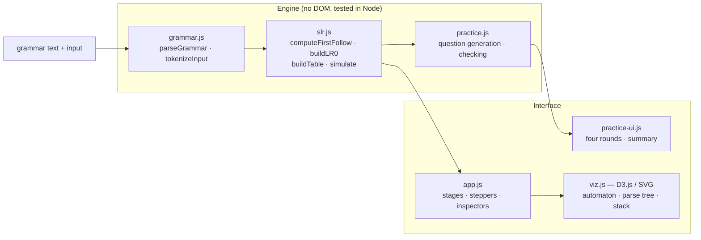
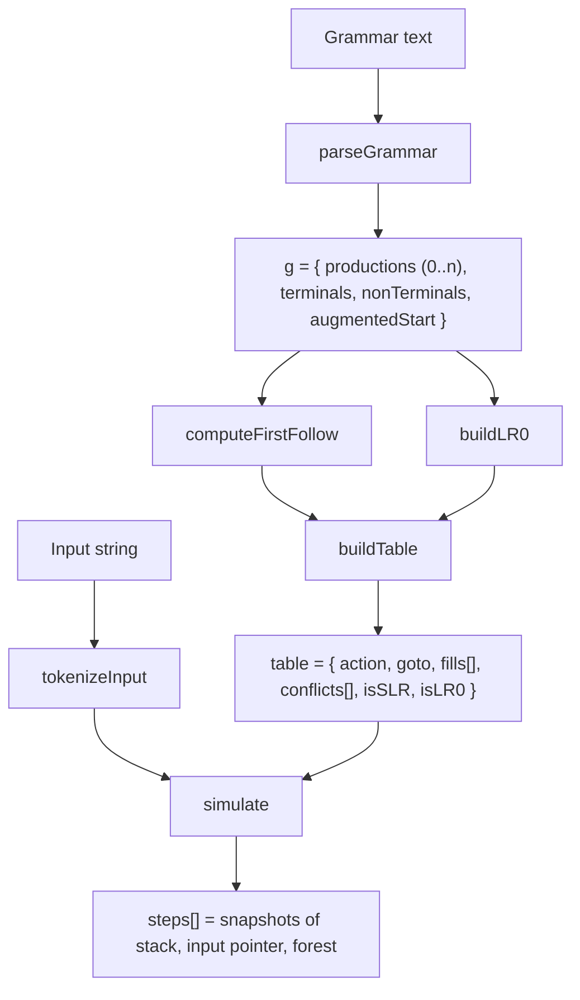

# Design and Algorithms

## 1. Architecture



The engine is a separate module from the interface (as stated in the abstract), so
the construction is checked against textbook results before it is drawn.

## 2. Data flow



Every stage returns the **steps** it took, not only its result:

| Function | Steps recorded | Used by |
|---|---|---|
| `computeFirstFollow` | one entry per symbol added to a set, with its reason and pass | Stage 2 stepper and log |
| `buildLR0` | `start`, then one `new` / `existing` entry per goto | Stage 3 stepper, automaton |
| `buildTable` | one entry per cell filled, with the rule (2a, 2b, 2c, 3) and reason | Stage 4 stepper, inspector |
| `simulate` | one snapshot per move (before the move) | Stage 6 stepper, trace, tree |

Because each parse step is a full snapshot, stepping backwards is just showing an
earlier snapshot; nothing is undone.

## 3. Algorithms

### 3.1 FIRST
Repeat over all productions until no set changes:
- `A → ε` puts ε in FIRST(A).
- `A → X1 X2 … Xn`: add FIRST(X1) − {ε}; if X1 ⇒* ε add FIRST(X2) − {ε}, and so on;
  if every Xi ⇒* ε, add ε. A terminal's FIRST is itself.

### 3.2 FOLLOW
1. `$ ∈ FOLLOW(S')`.
2. For `A → α B β`: FIRST(β) − {ε} ⊆ FOLLOW(B).
3. For `A → α B`, or `A → α B β` with β ⇒* ε: FOLLOW(A) ⊆ FOLLOW(B).

Repeated to a fixed point. The reason string records which rule and production
added each symbol.

### 3.3 closure and goto (Module 2, pp. 171–172)
- `closure(I)`: start with I; whenever `A → α • B β` is in the set and `B → γ` is a
  production, add `B → • γ`. Each added item records the item that caused it,
  shown in the interface as "closure of …".
- `goto(I, X)`: move the dot over X in every item of I with X after the dot, then
  take the closure.

### 3.4 Canonical collection
Breadth-first from `I0 = closure({S' → • S})`. Each state's symbols are explored
in the order they appear after a dot in its items. A goto result is compared with
existing states by its **kernel** (the set of `production.dot` pairs). This order
reproduces the textbook numbering: I0–I11 for the expression grammar and I0–I6 for
`S → AA`, which the tests check.

### 3.5 SLR(1) table (Module 2, p. 176)
For each state Ii:
- (2a) `[A → α • a β]` in Ii and goto(Ii, a) = Ij ⇒ ACTION[i, a] = shift j
- (2b) `[A → α •]` in Ii, A ≠ S' ⇒ ACTION[i, a] = reduce A → α for every a in FOLLOW(A)
- (2c) `[S' → S •]` in Ii ⇒ ACTION[i, $] = accept
- (3) goto(Ii, A) = Ij ⇒ GOTO[i, A] = j

A cell keeps a **list** of entries. A second, different entry makes it a conflict:
shift-reduce if a shift is involved, otherwise reduce-reduce (Module 2, p. 198).

**LR(0) check:** a state is an LR(0) conflict if it contains a completed item
together with any other completed item or any item with a terminal after the dot.

### 3.6 Parse simulation
```
stack = [0]; ip = 0
loop:
  s = top state, a = input[ip]
  ACTION[s, a] empty  → error (report position, a, and terminals with an entry in row s)
  shift j             → push (a, j); ip++
  reduce A → β        → pop |β| entries; t = new top; push (A, GOTO[t, A])
  accept              → done
```
The parse tree is built alongside: a shift pushes a leaf, and a reduce replaces the
top |β| subtrees with one node for A (an ε-reduction gets an ε leaf).

### 3.7 Practice checking
- Sets are compared as sets: `{ (, id }`, `( id` and `id,(` are equal; `eps`/`#`/`ε` mean ε.
- Table cells are normalised (`S5`, `shift 5` → `s5`; `R3` → `r3`; `accept` → `acc`;
  empty/`-` → error), and a conflict cell is compared as a set of entries.
- Questions use a seeded random generator, so the same seed gives the same paper.

## 4. Interface decisions

- **Back transitions as stubs.** A transition to a state in the same or an earlier
  column is drawn as a labelled tag under its source (`( → I4`) rather than a long
  arrow across the diagram, which is how textbooks keep the automaton readable.
  *All arrows* draws every transition as an arrow instead.
- **Colour carries meaning only:** blue = selection, amber = the current step,
  red = conflict, green = accept. It is always paired with text (`s6/r5`, "ACCEPT",
  "conflict"), so it does not depend on colour alone.
- **Exportable:** the SVG drawings carry their colours as attributes, so PNG export
  matches the screen. The print stylesheet hides the controls.
